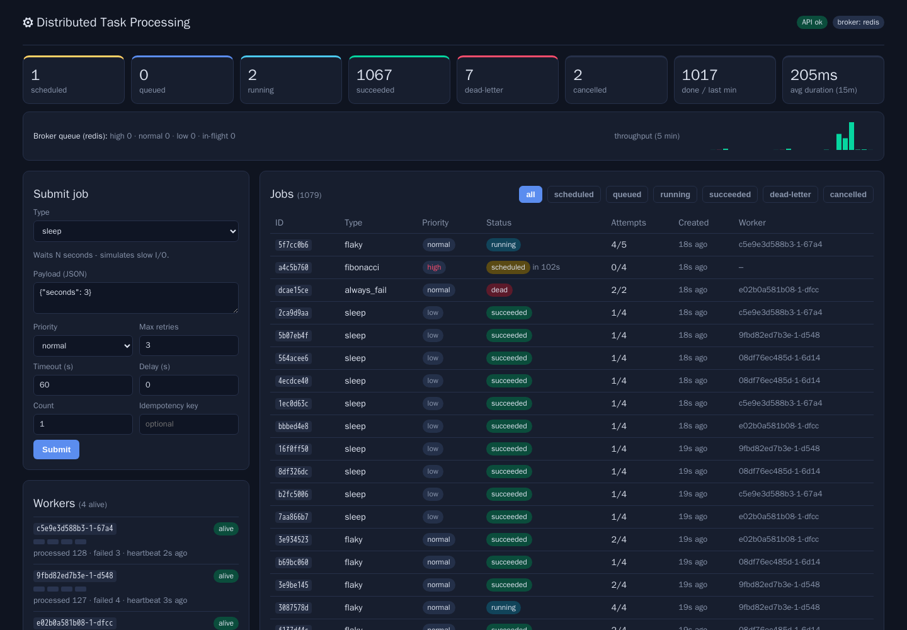
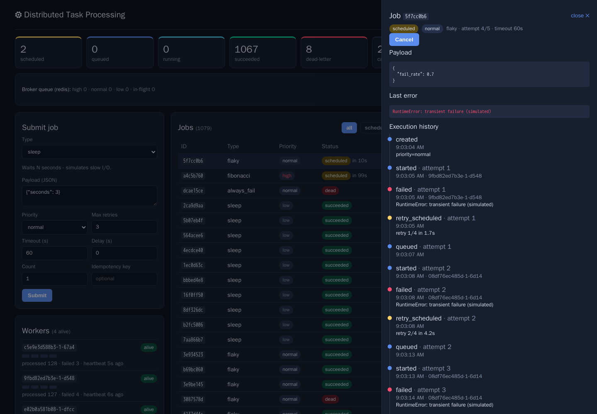
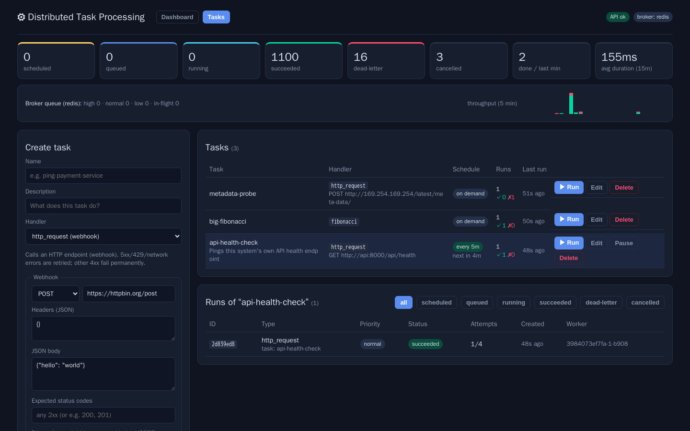

# Distributed Task Processing System

A Python backend for **submitting, scheduling and processing asynchronous jobs** through REST APIs.
It uses horizontally scalable workers and has **retries with exponential backoff, priorities, a dead-letter queue,
idempotency keys, crash recovery and job status tracking**. You can choose **Redis or RabbitMQ** as the queue,
and **PostgreSQL** holds the job and execution metadata. A React dashboard monitors everything live.
Users can also **create their own tasks** (reusable templates, including HTTP webhooks) and run them on demand
or on a repeating schedule.

    



## Architecture

```
            ┌───────────────┐   POST /api/jobs    ┌──────────────┐ 1. INSERT job (status=queued)  ┌──────────────┐
 client ───►│ React (nginx) │ ──────────────────► │  FastAPI API │ ─────────────────────────────► │  PostgreSQL  │
            └───────────────┘                     └──────┬───────┘                                │ jobs         │
                                                         │ 2. publish job id (after commit)       │ job_events   │
                                                         ▼                                        │ workers      │
                                    ┌─────────────────────────────────────────┐                   └──────▲───────┘
                                    │ Broker: Redis lists (high/normal/low)   │                          │
                                    │     or  RabbitMQ queue (x-max-priority) │                          │
                                    └───────────────┬─────────────────────────┘                          │
                              3. consume id         │                                                    │
                     ┌──────────────────────────────┼───────────────────────────────┐                    │
                     ▼                              ▼                               ▼                    │
              ┌────────────┐                 ┌────────────┐                  ┌────────────┐              │
              │  worker 1  │   ...           │  worker 2  │      ...         │  worker N  │ ── 4. claim / ─┤
              │ asyncio x4 │                 │ asyncio x4 │                  │ asyncio x4 │   result/fail  │
              └────────────┘                 └────────────┘                  └────────────┘                │
                                                                                                         │
              ┌────────────────────────────────────────────────────────────────────────┐                 │
              │ scheduler (leader via pg advisory lock): promote due/delayed jobs,      │ ────────────────┘
              │ reap expired leases (crashed workers), republish lost messages          │
              └────────────────────────────────────────────────────────────────────────┘
```

**Key idea:** PostgreSQL is the *source of truth* and the broker only carries job **ids**.
Delivery is *at-least-once*, and execution is guarded by an atomic claim
(`UPDATE jobs SET status='running' WHERE id=:id AND status='queued'`), so duplicate messages are harmless.

### Job lifecycle

```
create ─► SCHEDULED ─(run_at due)─► QUEUED ─(claimed)─► RUNNING ─► SUCCEEDED
   └─(no delay)────────────────────►  ▲                    │
                                      │                    ├─ fail, attempts left ─► SCHEDULED (backoff 2s,4s,8s… ±20% jitter)
             DEAD/CANCELLED ─retry────┘                    └─ fail, none left / PermanentError ─► DEAD (dead-letter queue)
SCHEDULED/QUEUED ─cancel─► CANCELLED          RUNNING with expired lease (worker crashed) ─► treated as a failed attempt
```



### Create task

The **Tasks** page (http://localhost:8080/#tasks) lets you create a reusable task. A task is a handler plus a default payload and an
execution policy, and it runs on demand or automatically. Each run is a normal job tagged with the task's name, so you get full history,
retries and the DLQ for free.



```bash
# A webhook that runs every 5 minutes
curl -X POST localhost:8000/api/tasks -H 'Content-Type: application/json' -d '{
  "name": "ping-partner-api", "handler": "http_request", "interval_seconds": 300, "max_retries": 5,
  "default_payload": {"method": "POST", "url": "https://httpbin.org/post", "body": {"ping": true}, "expected_status": [200]}
}'
curl -X POST localhost:8000/api/tasks/ping-partner-api/run -H 'Content-Type: application/json' \
  -d '{"payload": {"body": {"ping": "manual"}}}'      # run now, overriding part of the payload
curl 'localhost:8000/api/jobs?task=ping-partner-api' # its run history
```

## Features

| Feature | How |
|---|---|
| REST API | FastAPI with Pydantic validation and OpenAPI docs at `/docs` |
| Priorities | Redis: 3 lists popped in order by an atomic Lua script. RabbitMQ: native `x-max-priority` |
| Retries | exponential backoff with jitter (`base·2^(n-1)`, capped). `PermanentError` skips retries |
| Dead-letter queue | `status='dead'`, listed at `/api/dead-letter`, can be retried manually |
| Delayed jobs | `delay_seconds`, promoted by the scheduler using `FOR UPDATE SKIP LOCKED` |
| Timeouts | `asyncio.wait_for` per job. A timeout counts as a failed attempt |
| Crash recovery | lease = timeout + grace. The scheduler reaps expired leases and retries the job |
| Lost-message recovery | Redis in-flight ZSET with a visibility timeout, plus a stale-QUEUED republisher |
| Idempotency | unique `idempotency_key`. A replay returns the original job (HTTP 200) |
| Concurrency | asyncio semaphore per worker. Sync handlers run in a thread pool. RabbitMQ prefetch = concurrency |
| Horizontal scaling | `docker compose up --scale worker=N` (measured: 2 workers → 60 jobs/s, 4 → 119 jobs/s for 100 ms jobs) |
| Graceful shutdown | SIGTERM: stop consuming, drain in-flight jobs, mark the worker stopped |
| Scheduler HA | multiple replicas allowed. Leader election uses a PostgreSQL advisory lock |
| **Create tasks** | reusable task definitions (handler + default payload + priority/retries/timeout), run on demand with payload overrides, or **recurring** every N seconds/minutes/hours |
| Webhook tasks | `http_request` handler: method, URL, headers, JSON body, expected status codes. 5xx/429/network errors retry, other 4xx fail permanently |
| SSRF protection | user-supplied URLs that resolve to private, loopback, link-local or metadata IPs are blocked. Redirects are not followed. `HTTP_ALLOWED_HOSTS` is the allowlist |
| Observability | `job_events` audit trail, worker heartbeats, `/api/stats` (status counts, throughput, queue depth) |

## Quick start

```bash
docker compose up -d --build                  # Redis broker by default
# BROKER=rabbitmq docker compose up -d        # ...or RabbitMQ (management UI on :15672)
docker compose up -d --scale worker=4         # scale workers
```

- Dashboard: http://localhost:8080
- API docs: http://localhost:8000/docs

```bash
curl -X POST localhost:8000/api/jobs -H 'Content-Type: application/json' \
  -d '{"type": "flaky", "payload": {"fail_rate": 0.6}, "priority": "high", "max_retries": 3}'
curl localhost:8000/api/jobs/<id>          # status + full execution history
```

Built-in job types: `sleep`, `fibonacci`, `word_count`, `flaky` (random failures, shows retries),
`always_fail` (shows the DLQ), `http_check`, and `http_request` (webhook). To add your own, decorate a function in
`backend/app/handlers.py` with `@task("name", "description", example_payload)`.

## Tests

```bash
cd backend && pip install -r requirements-dev.txt
pytest -m "not integration"                          # unit: backoff, retry policy, handlers
API_URL=http://localhost:8080 pytest -m integration  # e2e against the running stack:
                                                     # success, retries→DLQ, permanent errors, timeouts,
                                                     # delayed jobs, cancel, idempotency, bulk + stats,
                                                     # tasks: CRUD, run + overrides, recurring/pause,
                                                     # webhook success/4xx, SSRF block
```

Both brokers pass the full integration suite. Crash recovery was verified by `SIGKILL`-ing every worker
mid-job: the scheduler reaped the expired leases and all jobs succeeded on attempt 2.

## API

| Method | Path | Description |
|---|---|---|
| POST | `/api/jobs` | submit `{type, payload, priority, max_retries, timeout_seconds, delay_seconds, idempotency_key}` |
| POST | `/api/jobs/bulk` | submit `count` copies (load testing) |
| GET | `/api/jobs?status=&type=&limit=&offset=` | paginated list |
| GET | `/api/jobs/{id}` | job + execution history |
| POST | `/api/jobs/{id}/cancel` | cancel scheduled/queued job (409 otherwise) |
| POST | `/api/jobs/{id}/retry` | re-run a dead/cancelled job |
| GET | `/api/dead-letter` | dead-letter queue |
| GET | `/api/stats` | counts by status/type, throughput series, avg duration, broker depth |
| GET | `/api/workers` | workers with heartbeat, active slots, processed/failed |
| GET | `/api/task-types` | registered handlers with example payloads |
| POST | `/api/tasks` | create a task `{name, description, handler, default_payload, priority, max_retries, timeout_seconds, interval_seconds, enabled}` |
| GET | `/api/tasks` | tasks with run counts and per-status stats |
| GET / PATCH / DELETE | `/api/tasks/{name}` | read / partially update (e.g. `{"enabled": false}` pauses it) / delete |
| POST | `/api/tasks/{name}/run` | run now `{payload overrides, delay_seconds, idempotency_key}` → job |
| GET | `/api/jobs?task={name}` | runs of a task |

## Layout

```
backend/app/
  api/main.py            REST API
  jobs.py                JobService: every state transition (submit, claim, complete, fail, cancel, retry)
  state.py               status enum, retry policy, backoff
  db.py                  SQLAlchemy models: jobs, job_events, workers
  brokers/               Broker interface + Redis (Lua, visibility timeout) + RabbitMQ (aio-pika)
  worker.py              consumer, concurrency, timeouts, heartbeats, graceful shutdown
  scheduler.py           leader election, delayed/retry promotion, lease reaper, republisher, recurring tasks
  tasks.py               TaskService: user-created task definitions, runs, recurring firing
  handlers.py            task registry
frontend/src/            React dashboard (polling)
docs/DESIGN.md           design decisions & trade-offs
```
